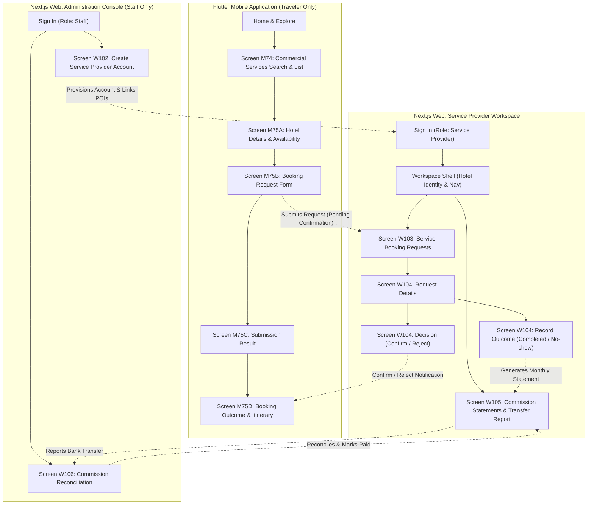
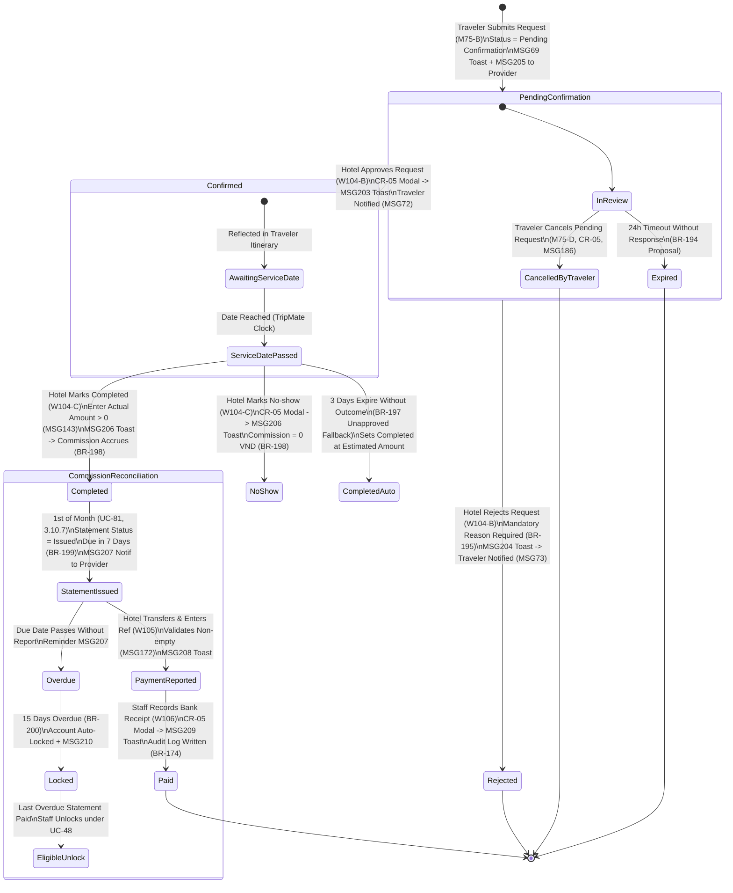

# 01 — INFORMATION ARCHITECTURE SPECIFICATION
## TRIPMATE HOTEL & COMMERCIAL SERVICE PROVIDER WORKFLOW
### Platform Boundaries, Navigation Architecture & Role Hierarchy

---

## 1. ACTOR TAXONOMY & PLATFORM OWNERSHIP

TripMate separates user workspaces strictly by actor responsibilities and platform paradigms. Hotel is a commercial service category operated by a **Service Provider** (not a standalone system role), which coexists alongside Vehicle Rental and Restaurant.



---

## 2. STRICT AUTHORIZATION & ROLE BOUNDARIES (§3.1.3)

| Actor | Workspace Permitted | Screens Accessible | Explicit Access Denials & Safeguards |
|---|---|---|---|
| **Traveler** | Flutter Mobile | M74, M75 (States A, B, C, D) | Cannot access Web Service Provider or Staff Console. If attempting web protected routes, receives redirect or 403. |
| **Service Provider** | Next.js Web (`/provider/*`) | W103, W104, W105 | **Forbidden:** Tour Operator Workspace (`/partner/*`), Web Administration Console (`/admin/*`). Accessing forbidden routes immediately triggers MSG126. |
| **Tour Operator** | Next.js Web (`/partner/*`) | Screens 75–92 (Tours, Coupons, Bookings, Payouts) | **Forbidden:** Service Provider Workspace (`/provider/*`), Admin Console (`/admin/*`). |
| **Staff** | Next.js Web (`/admin/*`) | W102, W106, Screens 34–54 (Users, POIs, Moderation) | **Forbidden:** Tour Operator Workspace, Service Provider direct booking operations. Staff cannot decide requests on behalf of hotel. |
| **Administrator** | Next.js Web (`/admin/*`) | Platform Governance, Staff Oversight, System Config | Has supervisory access; delegates operational commission reconciliation to Staff. |

---

## 3. WEB WORKSPACE NAVIGATION HIERARCHY

### 3.1 Service Provider Workspace Navigation Architecture

The Service Provider Workspace is designed exclusively for hospitality and commercial service operations. In accordance with SRS §3.6.3 and the master prompt directives:
- **No generic dashboard** is introduced.
- **No room inventory management or pricing override tools** are fabricated (these are managed via external PMS/centralized POI catalog).
- **First Landing Route:** Directly to `Screen W103: Service Booking Requests` (`/provider/bookings`).

```
Service Provider Workspace (`/provider`)
│
├── 1. Booking Requests (`/provider/bookings`) ─────── [SCREEN W103] (Default Landing)
│   ├── Filter & Search Controls (Status, Date Range, Keyword)
│   ├── Request Data Grid (Paginated 20/page, Pending first)
│   └── Request Details View (`/provider/bookings/[id]`) ── [SCREEN W104]
│       ├── Section A: Booking Specifications & Traveler Identity
│       ├── Section B: Provider Decision (Confirm / Reject with modal)
│       └── Section C: Record Service Outcome (Completed / No-show)
│
└── 2. Commission Statements (`/provider/statements`) ── [SCREEN W105]
    ├── Monthly Statement Summary Table
    └── Statement Details & Bank Transfer Reporting Panel
        ├── Completed Requests Audit Breakdown
        ├── TripMate Banking Reference Information
        └── Bank Transfer Reference Input & Submission
```

### 3.2 Staff Administration Navigation Architecture

Screens W102 and W106 are hosted within the existing Staff Administration Workspace (`/admin`), strictly decoupled from commercial partner views:

```
Staff Administration Workspace (`/admin`)
│
├── User Management (`/admin/users`)
│   └── [Action] Create Service Provider Account (`/admin/users/provider/new`) ── [SCREEN W102]
│       ├── Account Credentials & Business Identity
│       └── Linked Commercial POIs Selector (Active Hotels)
│
└── Commercial Finance & Settlements (`/admin/commercial-settlements`)
    └── Commission Reconciliation (`/admin/commercial-settlements/reconciliation`) ── [SCREEN W106]
        ├── Provider Statement Audit Grid (Payment Reported filter)
        └── [Action] Verify Bank Statement & Record Receipt (Modal confirmation)
```

---

## 4. MOBILE TRAVELER NAVIGATION HIERARCHY

Within the Traveler Mobile Application (Flutter, Android in Phase 1 per §4.2.5), the commercial hotel experience integrates into the existing Discovery and Itinerary workflows:

```
Traveler Mobile Navigation (Bottom Nav / Itinerary Tabs)
│
├── Explore / Catalog Tab
│   └── Commercial Services Search & List ───────────── [SCREEN M74]
│       ├── Hotel Category Filter Chip
│       ├── Service Cards (Hoi An, Da Nang, Hue properties)
│       └── Hotel Details Screen ────────────────────── [SCREEN M75 - State A]
│           ├── Hero Gallery & Hospitality Badges
│           ├── Room Types & Estimated Rate Scale
│           ├── Availability Status Indicator (Display-time, BR-55)
│           └── [CTA: Book Service] (Enabled if Active & Open)
│
├── Booking Request Funnel
│   └── Booking Form Sheet / Screen ─────────────────── [SCREEN M75 - State B]
│       ├── Date, Time, Room Option, Quantity Selector
│       ├── Traveler Contact & Special Requests
│       ├── Estimated Amount Calculation (Informational, BR-196)
│       └── [CTA: Submit Request] -> CR-05 Confirmation
│
├── Post-Submission Lifecycle
│   ├── Submission Confirmation View ────────────────── [SCREEN M75 - State C]
│   │   └── Request Code, Pending Notice, Response Timer
│   │
│   └── Itinerary & Trips Hub ───────────────────────── [SCREEN M75 - State D]
│       ├── Status: Pending Confirmation (With Cancel CTA)
│       ├── Status: Confirmed (Synced into Trip Schedule, MSG72)
│       ├── Status: Rejected (Detailed Rejection Reason, MSG73)
│       └── Status: Expired (24-hour timeout banner)
```

---

## 5. COMPLETE LIFECYCLE STATE MACHINE

The commercial service booking follows a strict linear state progression with finite terminal branches:



---

## 6. DATA MODEL RELATIONSHIPS (COMMERCIAL ENTITIES)

The commercial booking lifecycle relies on four primary schema entities defined in SRS §3.1.5 (Entities 37 & 38):

1. **`CommercialService` (POI Extension):**
   - Belongs to: `PointOfInterest` where `Category IN ('Hotel', 'Vehicle Rental', 'Restaurant')`.
   - Attributes: `ServiceId`, `PoiId`, `IsOpenForBooking`, `BasePriceMin`, `BasePriceMax`, `AvailabilitySchedule`.
   - Linked to: `ServiceProviderAccount` (1:1 mapping per BR-192).

2. **`ServiceOption` (Room Types for Hotel):**
   - Belongs to: `CommercialService`.
   - Attributes: `OptionId`, `ServiceId`, `OptionName` (e.g. Deluxe River View), `Capacity`, `UnitPriceVND`, `Description`.

3. **`ServiceBookingRequest` (Entity 37):**
   - Attributes: `RequestId`, `RequestCode` (Format: `HBR-YYYYMMDD-XXXX`), `PoiId`, `ServiceId`, `OptionId`, `TravelerId`, `RequestedDate`, `RequestedTime`, `Quantity`, `EstimatedAmountVND`, `ActualAmountVND`, `Status` (`PendingConfirmation`, `Confirmed`, `Rejected`, `Cancelled`, `Expired`, `Completed`, `NoShow`), `RejectionReason`, `RespondingStaffId`, `RespondedAt`, `SubmittedAt`.

4. **`CommissionStatement` (Entity 38):**
   - Attributes: `StatementId`, `StatementCode` (Format: `COMM-YYYYMM-XXXX`), `ProviderId`, `Period` (`MM/YYYY`), `CompletedCount`, `TotalActualAmountVND`, `CommissionAmountVND` (10% of Actual), `DueDate`, `Status` (`Issued`, `PaymentReported`, `Paid`, `Overdue`), `BankTransferReference`, `ReportedAt`, `ReconciledByStaffId`, `ReconciledAt`.
