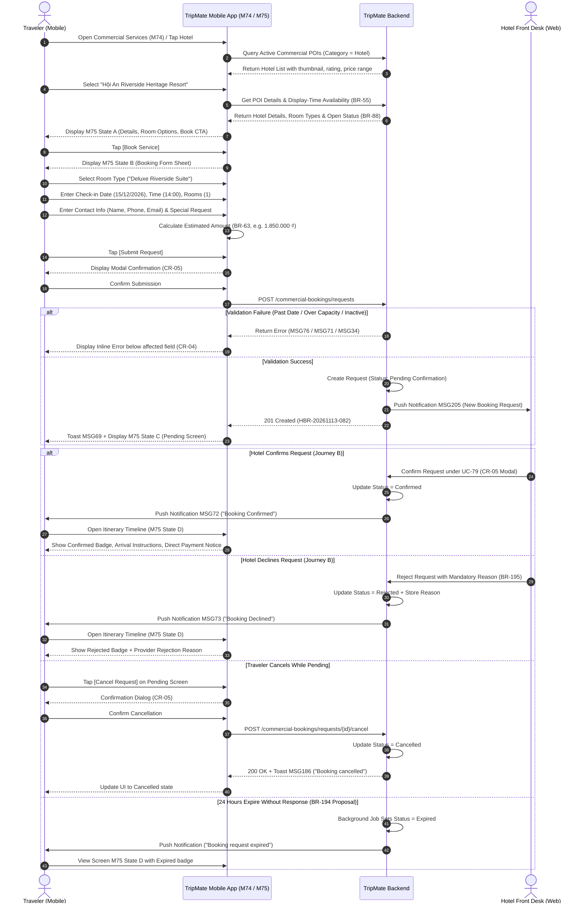
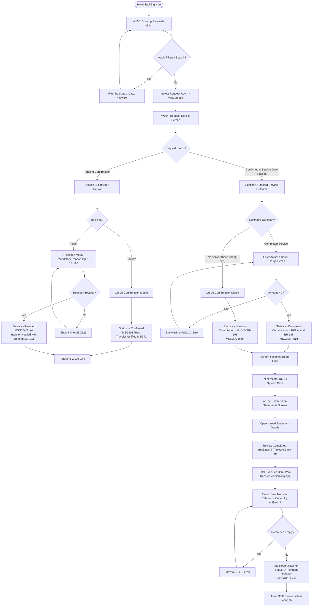
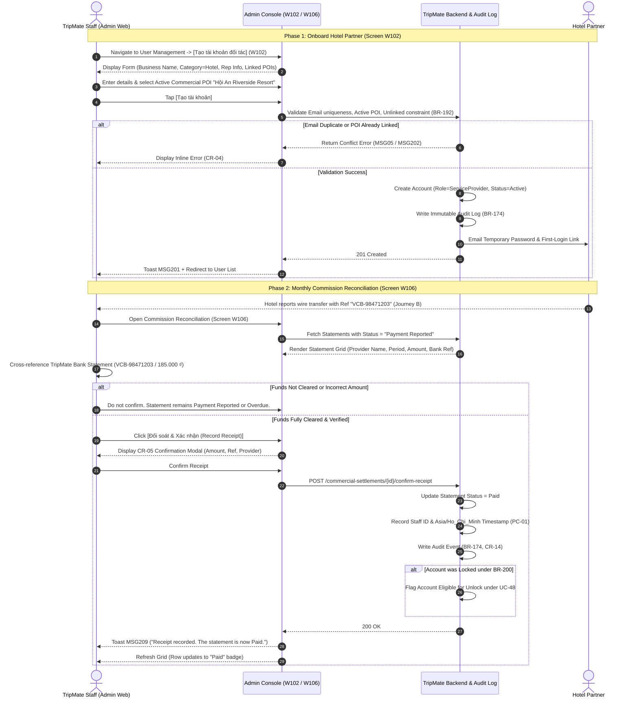

# 02 — END-TO-END USER JOURNEYS & INTERACTION FLOWS
## TRIPMATE HOTEL & COMMERCIAL SERVICE PROVIDER WORKFLOW
### Multi-Actor Workflows, Decision Trees & Error Recoveries

---

## JOURNEY A — TRAVELER MOBILE HOTEL DISCOVERY & BOOKING

### Overview
The Traveler discovers high-quality hospitality options in Central Vietnam (Da Nang, Hoi An, Hue), reviews room configurations and real-time availability, and submits a booking request. Crucially, the Traveler understands that **submitting a request is not an instant confirmation**; the Hotel must review and accept it. The Traveler pays the hotel directly upon arrival (BR-196).

### Visual Sequence Flow (Journey A)

### Detailed Flow Steps & Exceptions (Journey A)

1. **Normal Flow (Happy Path):**
   - **Step A1:** Traveler opens Search & List (Screen M74), filters by category `Khách sạn (Hotel)` in Central Vietnam.
   - **Step A2:** Traveler selects a verified hotel (e.g. *Hoi An Riverside Heritage Resort*). Screen M75 State A opens, showing photo gallery, star rating (4.8/5), location map preview, check-in policy, room types, and live availability badge.
   - **Step A3:** Traveler taps `[Đặt dịch vụ (Book Service)]`. Screen M75 State B opens as a focused booking modal sheet.
   - **Step A4:** Traveler selects room option *Deluxe Riverside Suite*, chooses check-in date (15/12/2026), check-in time (14:00), quantity (1 room), provides contact details, and adds special notes ("Early check-in if possible, high floor").
   - **Step A5:** System calculates Estimated Amount: `1.850.000 ₫`. Clear notice informs: *"Quý khách thanh toán trực tiếp tại khách sạn khi nhận phòng. TripMate không thu phí đặt trước."*
   - **Step A6:** Traveler taps `[Gửi yêu cầu đặt phòng (Submit Request)]`. CR-05 confirmation dialog appears: *"Xác nhận gửi yêu cầu đặt dịch vụ đến khách sạn?"*.
   - **Step A7:** Upon confirmation, request is recorded with status `Chờ xác nhận (Pending Confirmation)`. Screen M75 State C displays the Request Code `HBR-20261113-082` with toast MSG69.
   - **Step A8:** Hotel Front Desk confirms via Web. Traveler receives push notification MSG72.
   - **Step A9:** Traveler opens Trip Details (Screen M75 State D). Confirmed hotel reservation appears seamlessly pinned into their active trip itinerary.

2. **Alternative Flows:**
   - **Alt A1 — Traveler Cancellation:** If Traveler's plans change while the request is still `Pending Confirmation`, they open Screen M75 State D and tap `[Hủy yêu cầu]`. CR-05 modal prompts confirmation. Status switches to `Đã hủy (Cancelled)` with toast MSG186.
   - **Alt A2 — Hotel Rejection with Reason:** Hotel front desk cannot accommodate the dates and rejects with reason *"Phòng đã kín do đoàn sự kiện công ty"*. Status becomes `Đã từ chối (Rejected)`. Screen M75 State D displays this reason transparently, with a prompt to explore alternative dates or nearby hotels.

3. **Abnormal & Edge Cases:**
   - **Err A1 (Past Date):** Traveler selects yesterday's date. Inline error MSG76 (`The date must be in the future.`) prevents submission.
   - **Err A2 (Exceeded Availability):** Traveler requests 5 suites when only 2 remain. Inline error MSG71 (`Only 2 available for the selected date.`) blocks progress.
   - **Err A3 (Hotel Closed for Booking):** POI status switches to inactive or off-season. Primary CTA is disabled with notice MSG75 (`This service is not open for booking at the moment.`).

---

## JOURNEY B — HOTEL WEB OPERATIONS & COMMISSION RECONCILIATION

### Overview
Hotel reception staff signs into the **Service Provider Workspace** (`/provider`). They process incoming traveler requests, manage reservations, record real-world checkout outcomes, review monthly commission billing, and report bank wire transfer receipts back to TripMate.

### Visual Flow Diagram (Journey B)

### Detailed Flow Steps & Exceptions (Journey B)

1. **Normal Operational Flow:**
   - **Step B1:** Hotel Front Desk logs into the web workspace (`/provider/bookings`). Screen W103 displays all booking requests for their linked properties.
   - **Step B2:** A pending booking `HBR-20261113-082` appears highlighted at the top of the table. Staff clicks `[Xem chi tiết]`.
   - **Step B3:** Screen W104 displays full reservation information: guest name (*Nguyen Van An*), room type (*Deluxe Riverside Suite*), dates (15/12/2026 14:00), guest phone/email, and notes.
   - **Step B4:** Staff verifies room inventory in physical hotel PMS and clicks `[Xác nhận yêu cầu (Confirm)]`. CR-05 confirmation dialog opens: *"Xác nhận tiếp nhận đơn đặt phòng HBR-20261113-082 của khách hàng Nguyen Van An?"*. Staff confirms. Status updates to `Đã xác nhận (Confirmed)` with toast MSG203.
   - **Step B5 (Check-in & Service Delivery):** On 15/12/2026, the guest checks in, stays, and pays the hotel directly `1.850.000 ₫` at the front desk.
   - **Step B6 (Record Outcome):** After checkout date has passed, hotel staff opens request `HBR-20261113-082` in Screen W104. Section C (Record Outcome) is now enabled.
   - **Step B7:** Staff enters the actual charged amount `1.850.000 ₫`. The system dynamically previews the 10% commission (`185.000 ₫`). Staff clicks `[Ghi nhận hoàn thành]`. Status becomes `Hoàn thành (Completed)` with toast MSG206.
   - **Step B8 (Monthly Billing):** On the 1st of the following month (01/01/2027), the system background job (UC-81) aggregates all Completed bookings into statement `COMM-202612-0042` with status `Đã phát hành (Issued)`, due in 7 days.
   - **Step B9 (Settlement Reporting):** Hotel manager opens Screen W105 (`Bảng kê hoa hồng`), reviews the breakdown, transfers `185.000 ₫` via Vietcombank to TripMate's official account with description `COMM-202612-0042`, enters transaction reference `VCB-98471203`, and clicks `[Báo thanh toán]`. Status updates to `Đã báo thanh toán (Payment Reported)` with toast MSG208.

2. **Alternative & Rejection Flows:**
   - **Alt B1 — Request Rejection:** Staff finds no rooms available. They click `[Từ chối yêu cầu]` on Screen W104. A modal appears requiring a rejection reason. Staff selects preset or types *"Khách sạn đã hết hạng phòng Deluxe vào ngày quý khách chọn"* and submits. Status becomes `Đã từ chối (Rejected)`, Traveler receives push notification with reason, and toast MSG204 displays.
   - **Alt B2 — Guest No-Show:** Guest never arrives. Staff clicks `[Khách không đến (Mark No-show)]`. CR-05 confirmation modal prompts: *"Xác nhận ghi nhận khách không đến cho yêu cầu này? Hoa hồng phát sinh sẽ bằng 0 VND."*. On confirmation, status updates to `Vắng mặt (No-show)`, commission is set to 0 VND, and toast MSG206 confirms completion.

3. **Abnormal & Enforcement Flows:**
   - **Err B1 (Empty Rejection Reason):** Staff leaves rejection reason blank. Inline error MSG123 (`Please enter a reason.`) prevents modal submission.
   - **Err B2 (Invalid Outcome Amount):** Staff enters `0` or negative numbers in actual amount. Inline error MSG143 blocks the action.
   - **Err B3 (15-Day Overdue Account Lockout - BR-200 Proposal):** If the hotel fails to pay their commission statement within 15 days of the due date, system automatically locks the account, sets all hotel listings to inactive, and displays alert banner MSG210.

---

## JOURNEY C — STAFF WEB PROVISIONING & COMMISSION RECONCILIATION

### Overview
TripMate internal Staff uses the **Web Administration Console** (`/admin`) to provision verified commercial hotel partners, link them to active POIs, and verify banking commission receipts against incoming bank statements.

### Visual Sequence Flow (Journey C)

### Detailed Flow Steps & Exceptions (Journey C)

1. **Normal Account Provisioning Flow (Screen W102):**
   - **Step C1:** Staff navigates to `/admin/users/provider/new`.
   - **Step C2:** Staff inputs representative name (*Tran Thi Lan*), email (*lan.tran@hoianriverside.vn*), phone (*0905123456*), business name (*Hoi An Riverside Heritage Resort*), category dropdown (*Hotel*), and searches for active commercial POI *Hội An Riverside Heritage Resort (POI-DANANG-0042)*.
   - **Step C3:** Staff clicks `[Tạo tài khoản (Create Account)]`.
   - **Step C4:** System verifies that email is unique and POI is currently Active and not assigned to another provider (BR-192). System generates a hashed temporary password, sends email with onboarding link, writes creation event to audit log (BR-174), and displays toast MSG201.

2. **Normal Reconciliation Flow (Screen W106):**
   - **Step C5:** On the 5th of each month, Staff navigates to `/admin/commercial-settlements/reconciliation`.
   - **Step C6:** Filter defaults to `Đã báo thanh toán (Payment Reported)`. Staff reviews pending statement row for *Hoi An Riverside Heritage Resort*, showing Period *12/2026*, Commission *185.000 ₫*, Bank Reference *VCB-98471203*, and Reported Timestamp.
   - **Step C7:** Staff opens TripMate's corporate banking portal, confirms deposit of `185.000 ₫` with reference `VCB-98471203`.
   - **Step C8:** Staff returns to Screen W106 and clicks `[Đối soát & Xác nhận (Record Receipt)]`. CR-05 confirmation dialog displays: *"Xác nhận đã nhận đủ số tiền hoa hồng 185.000 VND từ đối tác Hội An Riverside Heritage Resort theo mã giao dịch VCB-98471203?"*.
   - **Step C9:** Staff confirms. Status updates to `Đã thanh toán (Paid)`. Staff ID and timestamp are stamped into the record (PC-01), immutable audit log entry is written, and toast MSG209 appears.

3. **Abnormal & Recovery Flows:**
   - **Err C1 (POI Already Linked):** Staff attempts to link a hotel POI already associated with another provider account. Inline error MSG202 (`This point of interest is already linked to another Service Provider account.`) blocks submission.
   - **Err C2 (Funds Not Received):** Bank wire reference is invalid or funds did not arrive. Staff does not click Confirm. The statement remains in `Payment Reported` until due date passes, after which it automatically transitions to `Quá hạn (Overdue)` with reminder MSG207 sent to provider.
   - **Err C3 (Re-attempting Reconciliation on Paid Record):** Attempting to process an already Paid statement is blocked with MSG133 (`This action is not available for the current status of the record.`).
