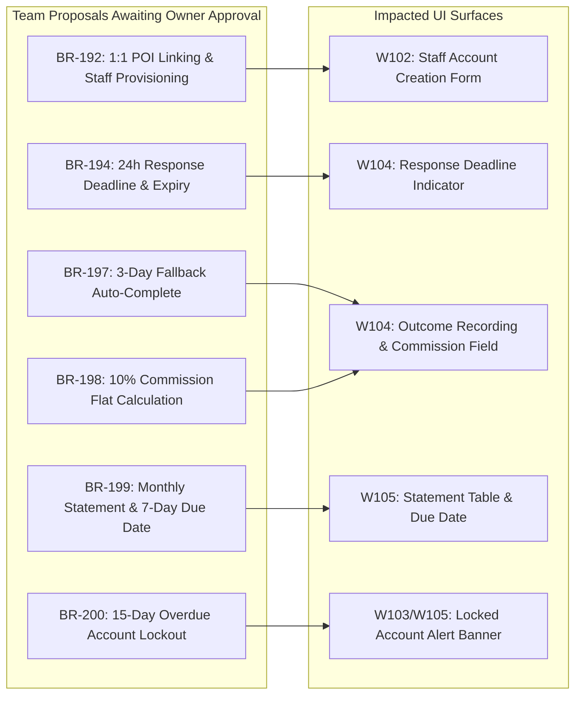

# 06 — OPEN DECISIONS & REQUIREMENT AMBIGUITY REGISTER
## TRIPMATE HOTEL & COMMERCIAL SERVICE PROVIDER WORKFLOW
### Governance of Unapproved Proposals, Ambiguities & UI Impact Analysis

---

## 1. GOVERNANCE MANDATE

In strict accordance with the Master Prompt instructions and the canonical Revision Log of `Report3_Software-Requirement-Specification.docx` (rows 60–63, updated 12/11/2026), **no team proposal awaiting Owner approval may be silently converted into finalized production behavior**.

This document registers every pending business rule, architectural ambiguity, and unresolved policy, detailing its exact UI manifestation and how the UI/UX design gracefully supports configurability without breaking business assumptions.

---

## 2. PENDING OWNER APPROVAL REGISTER

---

### ITEM OD-01: BR-192 — Service Provider Account Provisioning & POI Linking Rules
- **SRS Reference:** Revision Log row 61; §3.9.1.5; Table 12 §5.1.
- **Current Proposed Rule:** A Service Provider account is created only by Staff, with a unique email address, and is linked to at least one Active commercial POI (Hotel, Rental, Restaurant). A point of interest is linked to at most one Service Provider account (1:1 mapping). The system sends a temporary password and forces password change on first sign-in.
- **Approval Status:** `PENDING_OWNER_APPROVAL`.
- **UI Impact (Screen W102):**
  - The form restricts POI selection to unlinked Active commercial POIs.
  - If the Owner decides to allow multiple partner accounts per large hotel brand (1:N or N:M mapping), the single POI restriction message MSG202 will become obsolete.
- **Design Resolution:** Design Screen W102 with a multi-select lookup for commercial POIs, displaying a clear informational badge: `(Mô hình liên kết 1 POI - 1 Đối tác; Đang chờ Owner phê duyệt chính thức)`.

---

### ITEM OD-02: BR-194 — 24-Hour Provider Response Deadline & Auto-Expiry
- **SRS Reference:** Revision Log row 61; §3.6.4; §3.6.2 step 10.a1.
- **Current Proposed Rule:** A request in `Pending Confirmation` that receives no response within 24 hours of submission expires automatically and no service is reserved.
- **Approval Status:** `PENDING_OWNER_APPROVAL`.
- **UI Impact (Screens M75 State D & W104):**
  - Screen W104 displays a countdown timer: *"Hạn phản hồi: Còn XX giờ YY phút"*.
  - Screen M75 State D supports the `Đã hết hạn (Expired)` status badge.
- **Design Resolution:** Keep the 24h response countdown visually distinct in the prototype, but isolate the timer logic so that a different SLA (e.g. 12h, 48h, or business-hours only) can be configured via system parameters without altering screen layout.

---

### ITEM OD-03: BR-197 — Three-Day Outcome Fallback to Completed at Estimated Amount
- **SRS Reference:** Revision Log row 63; §3.6.5; §3.10.7.
- **Current Proposed Rule:** After the service date passes, if the Service Provider does not record Completed or No-show within 3 days, the system automatically sets the request to `Completed` at its initial estimated amount.
- **Approval Status:** `PENDING_OWNER_APPROVAL`.
- **UI Impact (Screen W104 Section C):**
  - Section C displays a reminder banner: *"Vui lòng ghi nhận kết quả dịch vụ trong vòng 3 ngày sau ngày nhận phòng. Sau 3 ngày, hệ thống sẽ tự động ghi nhận Hoàn thành theo giá ước tính (Quy tắc BR-197 đề xuất)."*
- **Design Resolution:** The outcome panel renders both manual inputs and the automatic fallback rule annotation. The fallback is clearly identified in the microcopy as an administrative safeguard awaiting final policy sign-off.

---

### ITEM OD-04: BR-198 — Fixed 10% Commercial Service Commission Rate
- **SRS Reference:** Revision Log row 63; §3.6.5; §3.6.6; §3.10.7.
- **Current Proposed Rule:** Service commission owed to TripMate is 10% of the actual amount of each Completed request, rounded down to whole VND. Rejected, Expired, Cancelled or No-show requests carry no commission.
- **Approval Status:** `PENDING_OWNER_APPROVAL`.
- **UI Impact (Screens W104 & W105):**
  - In Screen W104, when the hotel enters `Actual Amount = 2.000.000 ₫`, the preview shows `Commission = 200.000 ₫ (10%)`.
  - In Screen W105, total commission is summed.
- **Design Resolution:** Commission calculation is treated as a dynamic backend formula token. The UI displays the calculation formula explicitly (`Hoa hồng ước tính = 10% x Doanh thu thực tế`) with an info tooltip explaining that the rate is configurable per partner tier upon final contract approval.

---

### ITEM OD-05: BR-199 — Monthly Statement Generation on 1st & 7-Day Payment Period
- **SRS Reference:** Revision Log row 63; §3.6.6; §3.10.7.
- **Current Proposed Rule:** Statements are issued automatically on the 1st day of each month for the previous month's completed requests, with payment due within 7 days by bank transfer.
- **Approval Status:** `PENDING_OWNER_APPROVAL`.
- **UI Impact (Screen W105):**
  - Statements table displays due dates calculated as `Issue Date + 7 days`.
- **Design Resolution:** The statement header and due-date column render parameterized dates without hardcoding static 7-day text.

---

### ITEM OD-06: BR-200 — Automatic Service Provider Account Locking After 15 Overdue Days
- **SRS Reference:** Revision Log row 63; §3.6.6; §3.6.7; §3.9.1.3; §3.10.7.
- **Current Proposed Rule:** When a statement remains unpaid 15 days after its due date, the system automatically locks the Service Provider account and closes its commercial services for booking. Staff can unlock the account only after every overdue statement is Paid.
- **Approval Status:** `PENDING_OWNER_APPROVAL`.
- **UI Impact (Screens W103, W105, W106):**
  - Locked accounts display an alert banner MSG210: *"Tài khoản đã bị tạm khóa do bảng kê hoa hồng kỳ {Period} quá hạn 15 ngày."*
  - In Screen W106, reconciling the final overdue statement unlocks eligibility under UC-48.
- **Design Resolution:** Design the locked-account state and banner as an alert variant within the Web Shell, with clear annotations regarding the 15-day policy status.

---

## 3. SPECIFICATION & REQUIREMENT AMBIGUITIES

### AMBIGUITY 01: Default Sort Order on Screen W103 (Service Booking Requests)
- **SRS Source:** §3.6.3 Data Processing: *"The list is filtered by status, requested date and keyword, sorted by the requested date, and paginated according to CR-01."* Normal Flow step 3: *"with Pending Confirmation requests first."*
- **The Ambiguity:** The SRS specifies that `Pending Confirmation` requests appear first, followed by sorting on `Requested Date`. However, it does not explicitly declare whether `Requested Date` is sorted **Ascending (Earliest check-in date first)** or **Descending (Latest check-in date first)**.
- **UX Recommendation:**
  - For operational reception staff, **Ascending sort (Earliest check-in date first)** is functionally superior because reservations arriving today or tomorrow require urgent attention before reservations arriving next month.
  - **Status:** Marked `AMBIGUOUS_REQUIREMENT`. The prototype implements Ascending sort for Pending requests as the default, while providing interactive table column sort toggles (`▲ / ▼`) for the user.

---

### AMBIGUITY 02: Multi-Night Stay Support & Booking Form Fields
- **SRS Source:** §3.6.2 Screen Layout: *"Summary area: Service Name, Category, Address, Price Information. Input fields: Requested Date, Requested Time, Quantity, Selected Service Option, Special Request."*
- **The Ambiguity:** In the SRS, the fields are defined uniformly for all three commercial categories (Hotel, Rental, Restaurant). For a restaurant or vehicle rental, a single date + time + quantity is standard. For a hotel, however, guests typically require a check-in date and check-out date (number of nights).
- **Master Prompt Directive:** Master Prompt Section 5 explicitly dictates:
  > *"Do not invent additional mandatory booking fields. In particular, do not automatically introduce check-in/check-out dates, guest-count rules, room-inventory controls or payment fields unless verified in the SRS or an explicitly approved specification."*
- **Design Resolution:**
  - Strictly respect the Master Prompt directive.
  - The booking form uses the exact SRS fields: **Requested Date (Ngày nhận phòng)**, **Requested Time (Giờ nhận phòng)**, and **Quantity (Số lượng phòng)**.
  - The night duration is treated as 1 night baseline or documented in `Special Request (Yêu cầu đặc biệt)` until a formal multi-night amendment is approved by the Product Owner.

---

### AMBIGUITY 03: Hotel Room Inventory & Real-Time PMS Synchronization
- **SRS Source:** §3.6.1 BR-55: *"The availability information of a commercial service is retrieved at display time and is not a reservation."* §3.6.1 BR-88: *"A commercial service is presented as bookable only when the service is marked as open for booking and its availability for the intended date can be retrieved."*
- **The Ambiguity:** The SRS does not define an internal room-rate-calendar or inventory matrix editor for the Hotel in the Service Provider Workspace.
- **Design Resolution:** In strict alignment with §3.6.1 and prompt instructions, the Service Provider Workspace **does not invent a fake room-inventory module or rate manager**. Availability is retrieved from the centralized commercial POI service, and hotel staff reviews each request manually against their physical PMS before confirming or rejecting.
