# Đặc tả UI/UX Luồng Lưu trú — TripMate Web (Cập nhật nghiệp vụ Hotel / UC-31)

> **Phạm vi & tham chiếu:**
> - Thiết kế theo phong cách **TripMate Coastal Heritage**, giữ nguyên nền bố cục và component hiện có của `Capstone_FE` (`PublicNavigation`, `ViewSuggestedItineraryPage` tại `/itinerary/1`, `CreateSchedulingRequestForm`, `ProviderWorkspaceShell`).
> - Bao gồm **Traveler Web** (Tìm nơi ở, gửi yêu cầu lưu trú trực tiếp trên Web, theo dõi phản hồi, dùng khách sạn làm điểm xuất phát cho lịch trình) và **Hotel Operator** trong **Provider Web** (quản lý bài cơ sở đã Staff xác minh, bật/tắt nhận yêu cầu, phản hồi / từ chối yêu cầu).

---

## 1. Những điều chỉnh so với bản thiết kế cũ

| Hạng mục | Bản thiết kế cũ | Bản cập nhật nghiệp vụ Hotel / UC-31 mới nhất |
| --- | --- | --- |
| **Gửi yêu cầu trên Web** | Chọn hạng phòng, số phòng, lịch tồn theo đêm, tổng giá ước tính, đặt cọc / checkout hoặc chuyển sang Mobile | **Bỏ hoàn toàn** chọn hạng phòng, số phòng, lịch tồn, tổng giá, đặt cọc, checkout và chuyển sang Mobile. Chỉ gửi biểu mẫu gọn ngay trên Web với **ngày nhận/trả dự kiến**, **số khách**, **tên**, **email hoặc SĐT**, **ghi chú tùy chọn**. |
| **CTA & thông điệp trao đổi** | `Gửi yêu cầu` + `Thanh toán trực tiếp cho cơ sở` | CTA chính **`Gửi yêu cầu lưu trú`** + ghi chú bắt buộc trên form: **“Bạn sẽ trao đổi trực tiếp với cơ sở về phòng trống, giá, giữ chỗ và thanh toán.”** |
| **Trạng thái yêu cầu** | 4 trạng thái (`Chờ xác nhận`, `Đã xác nhận`, `Từ chối`, `Hết hạn`) | Đúng 3 trạng thái: **`Đã gửi`**, **`Cơ sở đã phản hồi`** (thay cho *Đã xác nhận phòng*), **`Đã từ chối`**. |
| **Gắn khách sạn với lịch trình** | Chỉ hiển thị thẻ phòng trong lịch trình | Bổ sung hành động tách biệt **`Dùng làm điểm xuất phát`** → mở form **Lập lịch trình** điền sẵn tên và địa chỉ khách sạn vào **`Điểm xuất phát`**, Traveler chủ động bấm tạo lịch để tính tuyến từ vị trí đó. |
| **Hotel Operator (Provider Web)** | Ngoài phạm vi Web Traveler trước đó | Bổ sung phần **Lưu trú** trên giao diện Provider Web hiện có với nhãn vai trò **`Hotel Operator`**: quản lý bài đã Staff xác minh, bật/tắt nhận yêu cầu, xem chi tiết yêu cầu và thao tác **`Gửi phản hồi`** / **`Từ chối yêu cầu`**. |

---

## 2. Luồng xuyên suốt (Traveler Web ↔ Hotel Operator)

```mermaid
flowchart LR
    T1["1. Chi tiết lịch trình (/itinerary/1)\nKhối Lưu trú riêng + Gợi ý lưu trú\n(Tuyến 8 điểm tham quan giữ nguyên)"]
    T2["2. Trang Lưu trú (/stays) &\nChi tiết khách sạn\nCTA 'Gửi yêu cầu lưu trú'\n(Hoặc 'Chưa mở nhận yêu cầu')"]
    T3["3. Kết quả sau khi gửi\nMã STAY-... · Trạng thái 'Đã gửi'\nGiữ liên kết chuyến đi Hội An"]
    OP1["4. Hotel Operator (Provider Web)\nHồ sơ cơ sở (đã Staff xác minh)\nBật/tắt nhận yêu cầu · Danh sách yêu cầu"]
    OP2["5. Chi tiết yêu cầu (Operator)\nNgày dự kiến · Số khách · Liên hệ · Ghi chú\n'Gửi phản hồi' / 'Từ chối yêu cầu'"]
    T4["6. Traveler xem phản hồi\nTrạng thái 'Cơ sở đã phản hồi'\n(hoặc 'Đã từ chối')"]
    T5["7. Lập lịch trình (/plan)\nBấm 'Dùng làm điểm xuất phát'\nĐiền sẵn Điểm xuất phát → Bấm tạo lịch"]
    T6["8. Lịch trình đã tính tuyến\nKhách sạn hiện nhãn 'Điểm xuất phát'\ntrên bản đồ · Khối Lưu trú tách riêng"]

    T1 -- "Tìm nơi ở / Gửi yêu cầu" --> T2
    T2 -- "Gửi yêu cầu lưu trú" --> T3
    T3 -. "Đồng bộ sang Provider Web" .-> OP1
    OP1 --> OP2
    OP2 -- "Gửi phản hồi" --> T4
    T4 -- "Dùng làm điểm xuất phát" --> T5
    T5 -- "Tạo lịch trình gợi ý" --> T6
```

---

## 3. Đặc tả chi tiết 3 phần thiết kế

### Phần 1 — Traveler: Tìm nơi ở và gửi yêu cầu lưu trú

1. **Trang Lưu trú riêng (`/stays`) & Khối `Gợi ý lưu trú` trong Chi tiết lịch trình (`/itinerary/1`):**
   - Thẻ cơ sở hiển thị: **tên cơ sở**, **địa chỉ**, **ảnh nếu có** (có khối hiển thị dự phòng lịch sự khi chưa có ảnh như *Nhà nghỉ Vườn Cau Cẩm Thanh*), và **trạng thái nhận yêu cầu** (`Đang nhận yêu cầu` hoặc `Chưa mở nhận yêu cầu`).
   - Cơ sở tạm đóng (*Khách sạn Cố Đô Huế*, hoặc khi Hotel Operator tắt công tắc nhận yêu cầu) vẫn mở được trang chi tiết để xem đủ thông tin (địa chỉ, hotline, mô tả, tiện ích) và hiển thị nhãn **`Chưa mở nhận yêu cầu`**, khóa form gửi yêu cầu.
   - Khi mở từ `/itinerary/1`, thanh ngữ cảnh giữ liên kết với chuyến đi *Hành trình khám phá Hội An 3 ngày (28–30/11/2026)*.
2. **Chi tiết khách sạn & Biểu mẫu `Gửi yêu cầu lưu trú`:**
   - Bố cục 2 cột `60% / 40%` trên Desktop, xếp dọc trên màn hình hẹp `390px`.
   - Biểu mẫu chỉ gồm các trường theo đúng nghiệp vụ UC-31:
     - **Ngày nhận dự kiến** & **Ngày trả dự kiến** (hiển thị số đêm tham khảo, không lịch tồn, không tổng giá).
     - **Số khách** (bộ tăng/giảm từ 1–20).
     - **Họ và tên** (bắt buộc).
     - **Email** hoặc **Số điện thoại** (bắt buộc nhập ít nhất 1 kênh).
     - **Ghi chú tùy chọn**.
     - Thẻ liên kết chuyến đi hiện tại (nếu mở từ lịch trình, cho phép bỏ gắn nếu cần).
   - Thông điệp bắt buộc ngay trên CTA chính:
     > **“Bạn sẽ trao đổi trực tiếp với cơ sở về phòng trống, giá, giữ chỗ và thanh toán.”**
   - Nút CTA chính: **`Gửi yêu cầu lưu trú`**.
3. **Kết quả & theo dõi yêu cầu:**
   - Hiển thị **mã yêu cầu** (`STAY-20261126-0148`), thông tin đã gửi, liên kết chuyến đi (nếu có) và đúng 3 trạng thái mã hóa kép (màu + biểu tượng + nhãn):
     - **`Đã gửi`** (Hổ phách `#FEF3E2` / `#92400E`): đã chuyển tới Hotel Operator của cơ sở.
     - **`Cơ sở đã phản hồi`** (Xanh ngọc `#E6F7F0` / `#065F46`): hiển thị khung trích dẫn nội dung phản hồi của cơ sở + hotline lễ tân + nút **`Dùng làm điểm xuất phát`**.
     - **`Đã từ chối`** (Hồng đỏ `#FDECEF` / `#991B1B`): hiển thị lý do từ chối từ cơ sở + lối tìm nơi ở khác.

---

### Phần 2 — Lịch trình: Dùng khách sạn làm điểm xuất phát

1. **Hành động tách biệt `Dùng làm điểm xuất phát`:**
   - Xuất hiện rõ ràng nhưng tách biệt khỏi `Gửi yêu cầu lưu trú` tại: thẻ cơ sở trên `/stays`, thẻ gợi ý trên `/itinerary/1`, tiêu đề Chi tiết khách sạn, và màn hình Kết quả khi `Cơ sở đã phản hồi`.
2. **Mở form Lập lịch trình (`/plan`) điền sẵn `Điểm xuất phát`:**
   - Khi Traveler bấm **`Dùng làm điểm xuất phát`**, hệ thống mở form Lập lịch trình với **tên và địa chỉ khách sạn** đã điền sẵn vào trường **`Điểm xuất phát`** (nổi bật bằng viền terracotta `#B96D4C` + nhãn `Đã điền từ khách sạn`).
   - Không tự động ghi đè hay chạy ngầm lịch trình: Traveler chủ động kiểm tra thời gian, phương tiện, điểm muốn ghé rồi bấm **`Tạo lịch trình gợi ý`** để tính tuyến từ khách sạn đó.
3. **Tách biệt rạch ròi giữa Lưu trú và Tuyến tham quan:**
   - Trong form Lập lịch trình: bộ chọn **`Địa điểm muốn ghé`** chỉ hiển thị các **điểm tham quan** (khi gõ từ khóa khách sạn/homestay sẽ hiển thị hướng dẫn mở trang Lưu trú riêng).
   - Trong Chi tiết lịch trình (`/itinerary/1`): khối **`Lưu trú`** nằm riêng ở cột phải, tách khỏi danh sách 8 điểm tham quan trình bày theo ngày ở cột trái. Trên **Bản đồ lộ trình**, khách sạn xuất hiện tại mốc `A` với nhãn **`Điểm xuất phát`**.

---

### Phần 3 — Hotel Operator trong Provider Web

1. **Giữ nguyên bố cục Provider Web hiện có (`ProviderWorkspaceShell.tsx`):**
   - Sidebar tối màu xanh ngọc di sản (`#172B29` → `#122422`) với vạch active `#D98A66`, nền nội dung `#F7F5EF`, nút chính `#174B4A`.
   - Hiển thị nhãn vai trò **`Hotel Operator`** cho `ServiceProvider` phụ trách cơ sở lưu trú (cả ở sidebar desktop và thanh tiêu đề di động `390px`).
2. **Hồ sơ cơ sở lưu trú (đã Staff xác minh) & Bật/tắt nhận yêu cầu:**
   - Hiển thị nhãn **`Đã được Staff xác minh`** + mã cơ sở (`POI #367`).
   - Công tắc **Trạng thái nhận yêu cầu lưu trú** cho phép Hotel Operator bật/tắt ngay lập tức — khi tắt, Traveler Web đồng bộ ngay trạng thái **`Chưa mở nhận yêu cầu`**.
   - Cho phép cập nhật mô tả giới thiệu, hotline trao đổi trực tiếp, giờ nhận/trả phòng tham khảo.
3. **Danh sách & Chi tiết yêu cầu lưu trú:**
   - Bảng danh sách hỗ trợ lọc theo 3 trạng thái (`Đã gửi`, `Cơ sở đã phản hồi`, `Đã từ chối`) và tìm theo mã yêu cầu / tên khách.
   - Chi tiết yêu cầu hiển thị đầy đủ: **ngày ở dự kiến**, **số khách**, **liên hệ (SĐT, email)**, **ghi chú của khách** (và lịch trình tham khảo nếu có).
   - Hai thao tác xử lý chính:
     - **`Gửi phản hồi`**: mở hộp thoại nhập nội dung phản hồi gửi Traveler → chuyển trạng thái thành **`Cơ sở đã phản hồi`**.
     - **`Từ chối yêu cầu`**: mở hộp thoại yêu cầu nhập lý do bắt buộc → chuyển trạng thái thành **`Đã từ chối`**.

---

## 4. Điểm gãy Responsive & kiểm chứng QA

- **Desktop (`1440×900`):** Bố cục 2 cột rõ ràng cho Traveler (`60/40` ở Chi tiết khách sạn & Chi tiết lịch trình, lưới 3 cột ở `/stays`, `50/50` ở `/plan`) và Sidebar cố định `260px` cho Hotel Operator.
- **Màn hình hẹp (`390×844`):**
  - Traveler Web: Menu ngăn kéo, form 1 cột, khối `Lưu trú` ưu tiên ngay phía trên danh sách điểm tham quan.
  - Hotel Operator: Chuyển sidebar thành thanh đầu trang tối màu Coastal Teal mang nhãn **`Hotel Operator`** + thanh tab cuộn ngang (`Yêu cầu lưu trú` | `Hồ sơ cơ sở lưu trú`), toàn bộ cặp khóa-giá trị tự ngắt dòng sạch sẽ, **0 tràn ngang** (`scrollWidth <= innerWidth`).
